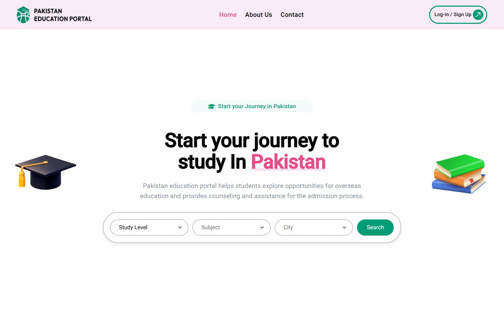
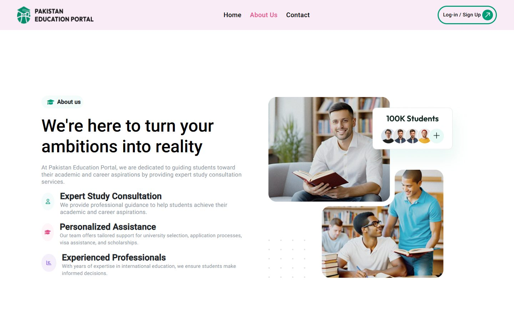
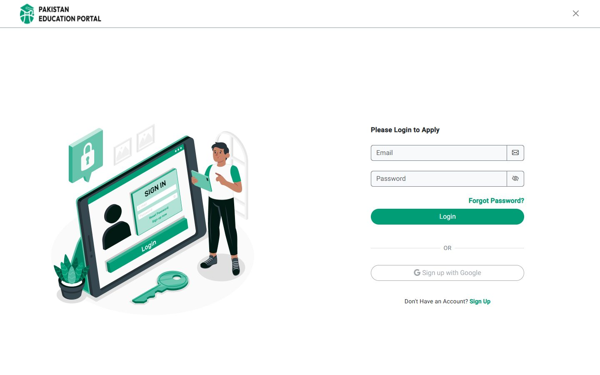

# Pakistan Education Portal (frontend)

**An Angular frontend where students search Pakistani universities and programs by study level, subject and city, then apply through the portal, while admins manage universities, registrations and site content.**

[](https://github.com/Umair-Habibx123/pakistan-education-portal/actions/workflows/ci.yml)
[](https://angular.dev)
[](https://getbootstrap.com)

> **About this repository.** I built this frontend with a small team during my Angular internship at
> [AIMS Soft](https://github.com/aims-soft). This repo is **our last version** from that internship
> (March to June 2025). AIMS Soft has continued developing the product in its own repositories and
> runs the official site at **[pakistaneducationportal.com](https://pakistaneducationportal.com/#/)**.
>
> The app talks to AIMS Soft's REST API, which isn't part of this repository. The development API
> server this version points to is no longer online, so a local copy shows the pages and forms but
> no university data.



## Features

**For students**
- Search universities and programs by **study level, subject and city**
- University listing and university detail pages with campus images and logos
- **Apply through us:** an application flow for admission, available after signing in
- Sign up, log in, forgot password, verification code and reset password screens
- About us and Contact pages

**For admins**
- Separate admin sign-in, with forgot and reset password
- Dashboard with Chart.js charts
- Manage universities, registrations, users, sliders, About us and the privacy policy
- Settings, including changing the password

**Throughout:** JWT sign-in sent by an HTTP interceptor, numbered pagination with ellipses, and a light/dark theme service. The theme toggle button is currently commented out.

| About us | Log in |
| --- | --- |
|  |  |

## Run it locally

You need **Node.js 18**, the newest version Angular 16 officially supports. Newer versions also built in testing.

```bash
git clone https://github.com/Umair-Habibx123/pakistan-education-portal.git
cd pakistan-education-portal
npm install
npm start          # http://localhost:4200
```

The API address lives in `src/environments/environments.ts` (`apiUrl` and `apiUrlauth`). Without a running backend, data-driven sections stay empty. `http.http` lists example API requests, for use with the VS Code REST Client.

| Command | What it does |
|---|---|
| `npm start` | Starts the dev server at http://localhost:4200 |
| `npm run build` | Builds the production site into `dist/education-portal/` |

## How it's built

| Part | What it uses |
|---|---|
| Framework | Angular 16 (NgModules), RxJS, Angular Router with hash URLs (`/#/...`) |
| UI | Bootstrap 5, Angular Material, SCSS |
| Charts | Chart.js |
| Backend | AIMS Soft's REST API (not included) |

```
libs/pages/      public site: home (search, universities, apply), about, contact, auth, navbar, footer
libs/admin/      admin area: auth, dashboard, universities, registrations, users, sliders, about us, privacy, settings
libs/service/    API services        libs/interceptor/   adds the sign-in token to API calls
DB_ERD.txt       database design (dbdiagram.io syntax), alongside Pakistan_Education_Portal.sql
```

## Credits

Built during an internship at [AIMS Soft](https://github.com/aims-soft) by [Umair Habib](https://github.com/Umair-Habibx123), together with M. Luqman, [hammadhere12](https://github.com/hammadhere12) and [haroonqadeer](https://github.com/haroonqadeer), who worked on services, image upload, admin pages, API integration and user management. The official, maintained version is at [pakistaneducationportal.com](https://pakistaneducationportal.com/#/).
